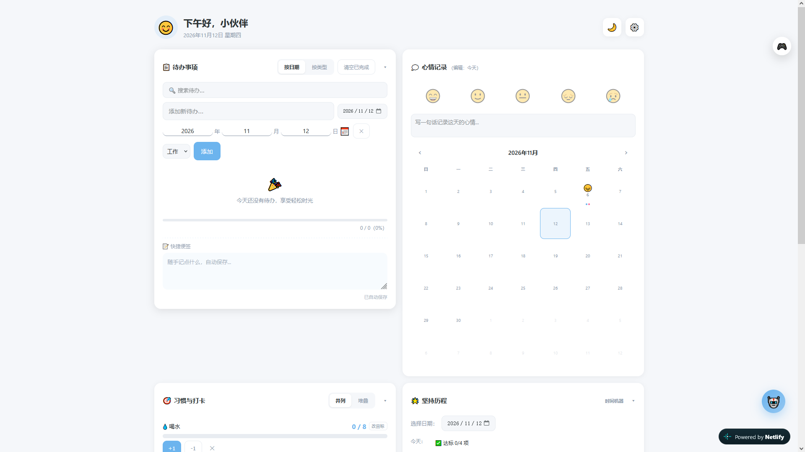

# 🌟 冉星 Novarise - 你的专属赛博生活仪表盘
> 原生技术栈构建的轻量化个人仪表盘，聚合生活管理、AI 助手与多游戏成绩查询，做你赛博生活的中央控制台。

## ✨ 核心特性
1. 全栈零框架：前端仅 HTML/CSS/JS 三文件，后端纯 FastAPI 单文件，无构建工具、无冗余依赖，开箱即用。
2. 多游戏成绩聚合：对接水鱼查分器开放 API，实时获取舞萌 DX B50、单曲成绩与段位数据；无状态透传架构，后端不存储任何用户 Token。
3. 多模型 AI 助手：支持百炼、豆包、魔搭等多平台大模型自由切换，内置流式输出与深度思考过程展示。
4. 沉浸式交互体验：全局卡片式折叠布局、深浅色主题无缝切换、移动端全适配，支持时间机器回溯历史数据。
5. 隐私优先设计：所有第三方 Token、本地数据均存储于浏览器端；后端全程无状态、无数据库、无用户体系，请求用完即焚。

## 🏗️ 技术架构
1. 前端：原生 JavaScript 单页应用，零框架依赖，静态托管于 Netlify，自带全球 CDN 加速。
2. 后端：Python FastAPI 异步接口，纯透传无状态设计，部署于魔搭 ModelScope 免费算力空间。
3. 链路优化：通过 Netlify _redirects 实现同域代理，绕过云端网关跨域拦截，前端无感调用。

## 📅 更新计划与日志
详细版本更新记录请查看 [CHANGELOG.md](./CHANGELOG.md)。

## 🔧 本地开发与部署
### 💻 本地运行
#### 1. 前端启动 (Frontend)。
  1. 将项目克隆至本地后，使用 VSCode 打开前端根目录。
  2. 安装并启用 Live Server 插件，右键 index.html 选择 Open with Live Server。
>⚠️ 警告：禁止直接双击 HTML 文件打开。file:// 协议会导致浏览器的安全策略拦截 fetch 请求，且可能导致 localStorage 失效。
  3. 本地联调后端：若后端服务运行在本地，请找到 app.js 中的 const API_BASE = '';，临时修改为 const API_BASE = 'http://127.0.0.1:8080';，即可直接请求本地接口。

#### 2. 后端启动 (Backend)
  1. 进入后端目录，建议使用虚拟环境隔离依赖：
```bash
     # 创建虚拟环境
     python -m venv .venv
     # 激活虚拟环境 (Windows)
     .venv\Scripts\activate
     # 激活虚拟环境 (Mac/Linux)
     source .venv/bin/activate
```

  2. 安装所需依赖：

```bash
     pip install -r requirements.txt
```

  3. 启动服务（默认监听 8080 端口）：
```bash
     python main.py
```

  4. 启动成功后，访问 http://127.0.0.1:8080/docs 即可查看自动生成的 Swagger 接口文档，进行接口自测。

### 🌐 线上部署
#### 1. 前端：Netlify 静态托管
  1. 将代码推送至 GitHub 仓库。
  2. 在 Netlify 中关联该仓库。构建命令留空，发布目录（Publish directory）选择前端文件所在目录。
  3. ⚠️ 核心配置：确保前端根目录下包含一个名为 _redirects 的文件，内容为：
```text
    /api/*  https://Si00008-novarise-api.ms.show/api/:splat  200
```
    (此配置用于绕过云端跨域拦截，通过 Netlify 边缘节点进行 API 代理。)

  4. 部署完成后，Netlify 会自动分配公网域名（如 xxx.netlify.app）。

#### 2. 后端：魔搭 ModelScope 创空间
  1. 登录魔搭社区，新建一个 Python 类型的创空间 (Studio)。
  2. 将 main.py、requirements.txt 以及必要的 Docker 配置文件上传至空间根目录。
  3. 平台会自动识别 requirements.txt 进行依赖安装，并读取 main.py 启动 FastAPI 服务。
  4. 获取魔搭分配的公网 API 地址（如 https://xxx.ms.show）。
  5. 将该地址填入前端根目录的 _redirects 代理文件中，重新触发 Netlify 部署即可完成全链路联调。

## 🤝 参与贡献
欢迎提交 Issue 反馈问题，或提交 PR 优化功能与体验。
如果项目对你有帮助，欢迎点个 Star ⭐ 支持一下。
